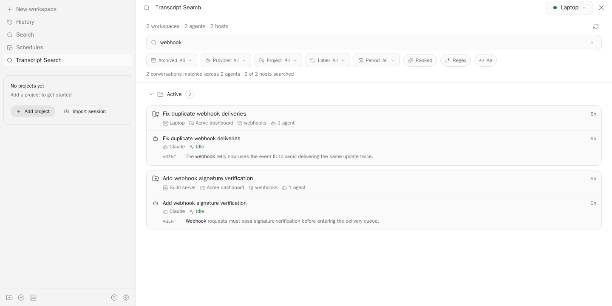

# paseo-transcript-search

[](https://paseo.sh)
[](https://github.com/tomgrin10/paseo-transcript-search/actions/workflows/verify.yml)
[](LICENSE)

Find something said in a previous Paseo session, across all your connected hosts.



Example with synthetic sessions on a laptop and build server.

## Install

Requires [Paseo](https://paseo.sh) **0.11.0 or newer** on the daemon and connected app. Enable plugins in **Settings → Plugins**, then run on each host you want to search:

```sh
paseo plugin install https://github.com/tomgrin10/paseo-transcript-search --id transcript-search
```

Update with `paseo plugin update transcript-search`. Keep the same installation ID on every host.

## Use

- Open **Transcript Search** from the sidebar, or press **⌘K / Ctrl+K**, choose **Search all session transcripts**, and start typing.
- Search active and archived sessions, including Claude subagents and archived Codex conversations.
- Narrow results by project, provider, labels, date, or archive status. Literal, case-insensitive search is the default; regex, case sensitivity, and relevance ranking are optional.
- Open a matching session on its original host. Archived sessions ask for confirmation before restoration.

Open a workspace or plugin on a host first to make its Command Center actions available.

### Multiple hosts

Configure your hosts in Paseo and install this plugin on each. One search queries all online hosts in parallel and labels results with their source. No extra plugin connection setup is needed.

Disconnected hosts, missing plugin installations, and failed searches are named in the screen. Results from healthy hosts stay available; **Refresh** retries failed requests. Copied session and project IDs remain separate between hosts.

### Sidebar visibility

In **Settings → Plugins → Transcript Search → Display**, turn **Show in sidebar** off to hide its menu entry. Keyboard access stays available. The host saves this preference across reloads and updates; other connected clients apply changes within five seconds.

## Data and access

Paseo plugins run trusted, unsandboxed code on the daemon host. This plugin reads session records under `$PASEO_HOME` (`~/.paseo` by default) and provider transcripts from their configured directories. It uses the authenticated Paseo connections already open in your app.

Transcripts stay on their originating hosts; search returns matching snippets to connected clients. Provider persistence credentials are excluded from history responses. Missing transcript files do not stop other sessions from being searched, and searches cover all selected sessions in bounded batches. Timeout and output-limit notices identify incomplete results.

Literal and regex searches use the host's `grep`. Windows hosts need a compatible `grep`, such as the copy included with Git for Windows. Optional ranked search uses built-in SQLite FTS5 and falls back to grep when the index is unavailable. Each host owns its index; when hosts use different search engines, results retain chronological grouping.

## Development

```sh
git clone https://github.com/tomgrin10/paseo-transcript-search.git
cd paseo-transcript-search
npm ci
npm run verify
paseo plugin install "$PWD" --id transcript-search
```

After changes, run `npm run verify` and `paseo plugin reload transcript-search`. Reloading the plugin is enough; keep the daemon running.

## More Paseo plugins

- [Defer](https://github.com/tomgrin10/paseo-defer) — Schedule messages for later delivery.
- [Graphite](https://github.com/tomgrin10/paseo-graphite) — Graphite stacks and PR status.
- [Smart Session](https://github.com/tomgrin10/paseo-smart-session) — Context compaction and usage insights.
- [Vitals](https://github.com/tomgrin10/paseo-vitals) — Host, agent, and Docker health.
- [Send to Paseo](https://github.com/tomgrin10/send-to-paseo) — Send PRs to Paseo from Chrome.

## License

[MIT](LICENSE). Adapted from [panrafal's agents-history](https://github.com/panrafal/paseo-plugins/tree/004c6a80c6aa8e76bb563694c3eee5c2c0b0466f/agents-history), pinned at `004c6a80c6aa8e76bb563694c3eee5c2c0b0466f`. The original attribution is preserved in the license.
