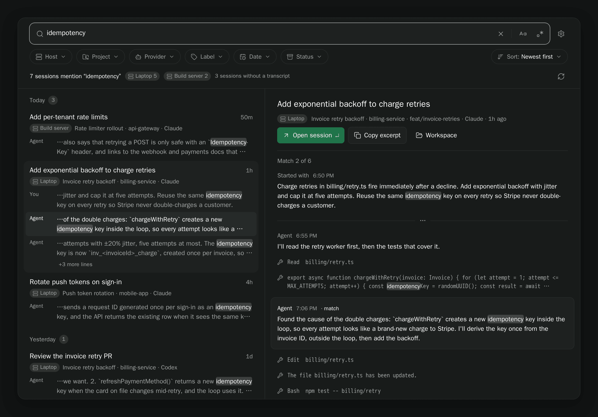
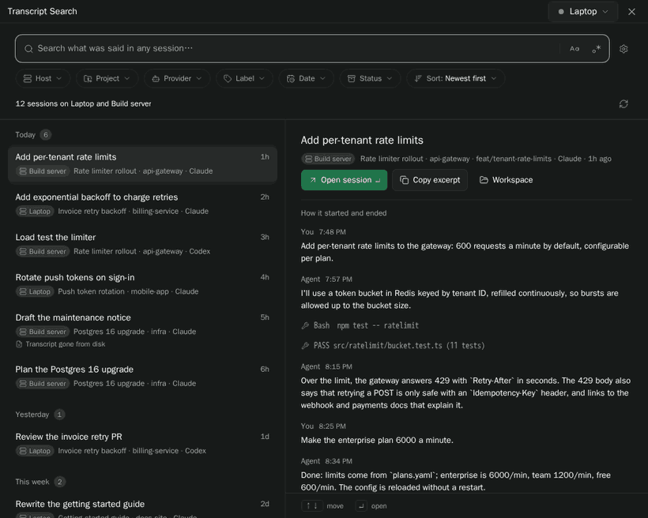
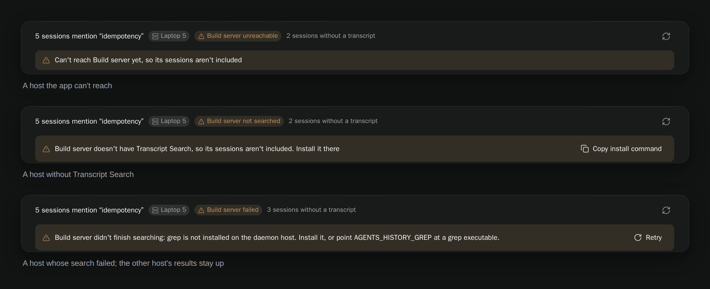
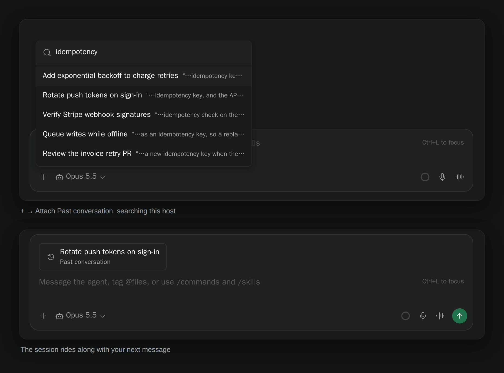
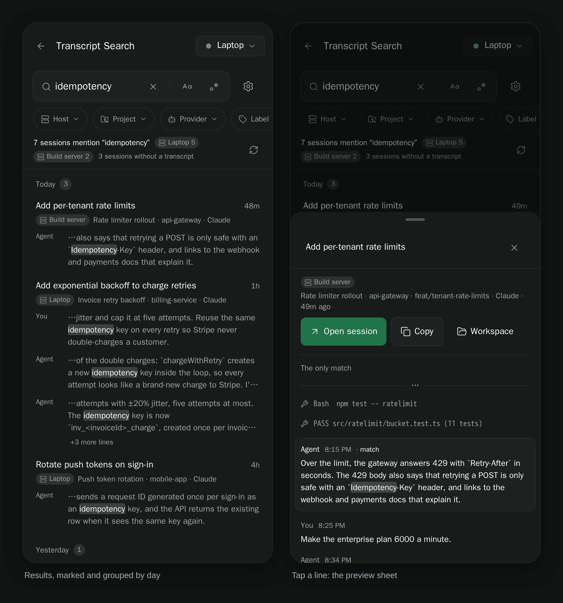

# paseo-transcript-search

[](https://www.npmjs.com/package/paseo-transcript-search)
[](https://www.npmjs.com/package/paseo-transcript-search)
[](https://paseo.sh)
[](LICENSE)

Find something said in any past Paseo session, on every connected host. Type a few words and see which sessions said them, with the words marked; read the match in its conversation; open the session on its own host, or attach the excerpt to the session you're in. Active and archived sessions, Claude subagents and Codex included.

<picture>
  <source media="(prefers-color-scheme: light)" srcset="docs/media/transcript-search-hero-light.png">
  
</picture>

Screenshots use synthetic sessions on two hosts, Laptop and Build server.

## Install

Run on each host you want to search:

```sh
paseo plugin install paseo-transcript-search
```

## Use

Open **Transcript Search** from the sidebar, choose **Search all session transcripts** from ⌘K / Ctrl+K, or type `/recall webhook retries` in any session, and start typing.

- **Results are sessions**, newest first and grouped by day, each with up to three matching lines and every occurrence marked. Each one names its host. **Sort: Best match** ranks them by relevance instead.
- **Read before you open.** Select a line and the preview shows it in its conversation: how the session started, the turns around it, tool calls as one line. On a phone it opens as a sheet.
- **Keyboard first.** ↑ and ↓ walk the matching lines across sessions and the preview follows, Enter opens the session on its host, Esc clears the search, `/` jumps back to the field. A double click opens too.
- **Archived sessions ask first.** Opening one offers **Restore and open**, and says that the conversation itself is unchanged.
- **Filters**: host, project, provider, label, date and status (active or archived). **Aa** matches case and **.\*** takes a regular expression, both inside the field.
- **Recent searches** wait under an empty field. They stay on this device.



Every host answers on its own. The status line counts sessions per host, and a host that is offline, lacks the plugin or fails its search is named with what to do (Retry, or the install command to copy); the other hosts' results stay up.



### Attach a past conversation

In any session, press **+** in the message box and choose **Attach Past conversation**. Search what was said, pick a session, and it rides along with your next message: its title, workspace and host, the lines that matched in their turns (or how it started and its last turns), and how to read more. The list comes from the host the session runs on.



### For agents

With Paseo tools enabled, Claude and Codex sessions get two tools. Their calls show in the chat as one line each, and open to what they found or read.

| Tool | What it does |
| --- | --- |
| `transcript_search_conversations` | Searches this workspace's sessions (or the project's, or the whole host's) and returns the matching lines with each session's title, workspace and line numbers |
| `transcript_read_conversation` | Reads the turns around one of those lines, or how a session started and ended |

Neither restores, starts or messages a session.


On a phone the filters scroll in one row and the preview opens as a sheet with the actions on top.



## How it works

Transcripts stay on their own hosts; only matching lines and short excerpts reach the app. Literal and regex search use the host's `grep` (Windows hosts need one, such as Git for Windows'). Best match uses a SQLite FTS5 index built the first time you ask for it, and answers with `grep` until the index is ready. Large histories are searched in batches of 2,000 sessions; timeouts and output limits are reported as incomplete results, never silently dropped. Excerpts are read from the transcript a few turns at a time, skipping lines too large to parse.

**Settings → Plugins → Transcript Search → Display** hides the sidebar row (⌘K and `/recall` still work) and clears recent searches.

## Data and access

Paseo plugins run trusted, unsandboxed code on the daemon host. Transcript Search reads Paseo's session records under `$PASEO_HOME` and the providers' transcripts (`~/.claude/projects`, `~/.codex/sessions` and `archived_sessions`), read-only. Provider credentials in session records are dropped before anything leaves the host. The only thing it writes is the disposable search index, `$PASEO_HOME/plugin-data/agents-history/search.sqlite`; recent searches stay in the app on your device.

## Development

```sh
npm ci
npm run verify
paseo plugin install . --id transcript-search
paseo plugin reload transcript-search   # after changes
```

## License

[MIT](LICENSE). Adapted from [panrafal's agents-history](https://github.com/panrafal/paseo-plugins/tree/004c6a80c6aa8e76bb563694c3eee5c2c0b0466f/agents-history); the original attribution is preserved in the license.

## Other plugins

- [Defer](https://github.com/tomgrin10/paseo-defer) — Schedule messages for later delivery.
- [Follow-up](https://github.com/tomgrin10/paseo-follow-up) — Track workspace PRs, remaining tasks and completion.
- [Send to Paseo](https://github.com/tomgrin10/send-to-paseo) — Send GitHub and Graphite PRs to Paseo from Chrome.
- [Session Guard](https://github.com/tomgrin10/paseo-session-guard) — Pause at session limits and continue after reset.
- [Smart Session](https://github.com/tomgrin10/paseo-smart-session) — Context compaction and usage insights.
- [Transfer](https://github.com/tomgrin10/paseo-transfer) — Copy or move workspaces between hosts.
- [Vitals](https://github.com/tomgrin10/paseo-vitals) — Host, process, agent and Docker monitoring.
- [Workspace Switcher](https://github.com/tomgrin10/paseo-switcher) — Arc-style Ctrl+Tab between recent workspaces.
