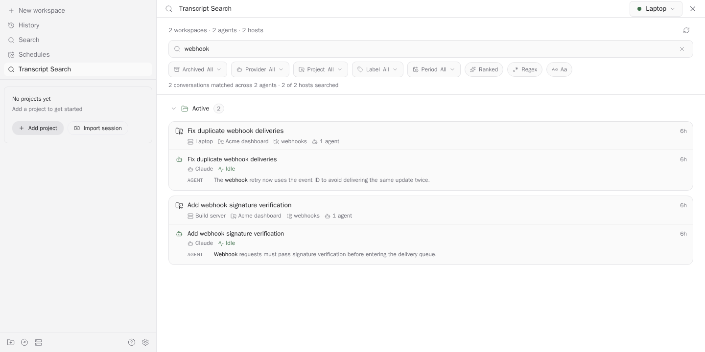

# paseo-transcript-search

[](https://www.npmjs.com/package/paseo-transcript-search)
[](https://www.npmjs.com/package/paseo-transcript-search)
[](https://paseo.sh)
[](LICENSE)

Find something said in a previous Paseo session, across all your connected hosts.



Example with synthetic sessions on a laptop and build server.

## Install

Run on each host you want to search:

```sh
paseo plugin install paseo-transcript-search
```

## Use

Open **Transcript Search** from the sidebar, or choose **Search all session transcripts** from ⌘K / Ctrl+K, and start typing.

- Searches active and archived sessions, including Claude subagents and archived Codex conversations.
- Filter by project, provider, label, date or archive status. Search is literal and case-insensitive by default, with regex, case sensitivity and relevance ranking as options.
- Open a result on its original host. Archived sessions ask before they are restored.
- Agents can search with `transcript_search_conversations`, scoped to their own workspace unless they ask for a project or host.

One search queries every online host in parallel and labels each result with its host. Offline hosts and failed searches are named on screen, and **Refresh** retries them.

## How it works

Transcripts stay on their own hosts; only matching snippets reach the app. Literal and regex search use the host's `grep` (Windows hosts need one, such as Git for Windows'). Ranked search uses SQLite FTS5 and falls back to `grep` when the index is unavailable. Large histories are searched in bounded batches, and timeouts or output limits are reported as incomplete results.

## Development

```sh
npm ci
npm run verify
paseo plugin install . --id transcript-search
paseo plugin reload transcript-search   # after changes
```

## License

[MIT](LICENSE). Adapted from [panrafal's agents-history](https://github.com/panrafal/paseo-plugins/tree/004c6a80c6aa8e76bb563694c3eee5c2c0b0466f/agents-history); the original attribution is preserved in the license.

## Other plugins

- [Defer](https://github.com/tomgrin10/paseo-defer) — Schedule messages for later delivery.
- [Follow-up](https://github.com/tomgrin10/paseo-follow-up) — Track workspace PRs, remaining tasks and completion.
- [Graphite](https://github.com/tomgrin10/paseo-graphite) — Graphite stacks and PR status.
- [Send to Paseo](https://github.com/tomgrin10/send-to-paseo) — Send GitHub and Graphite PRs to Paseo from Chrome.
- [Session Guard](https://github.com/tomgrin10/paseo-session-guard) — Pause at session limits and continue after reset.
- [Smart Session](https://github.com/tomgrin10/paseo-smart-session) — Context compaction and usage insights.
- [Transfer](https://github.com/tomgrin10/paseo-transfer) — Copy or move workspaces between hosts.
- [Vitals](https://github.com/tomgrin10/paseo-vitals) — Host, process, agent and Docker monitoring.
- [Workspace Switcher](https://github.com/tomgrin10/paseo-switcher) — Arc-style Ctrl+Tab between recent workspaces.
